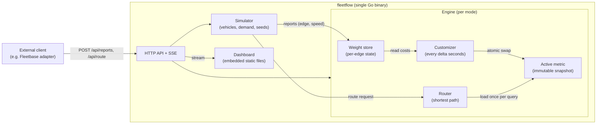

# FleetFlow: Design

**An open-source fleet navigation platform with dynamic weights.**
It keeps a fleet from congesting its own roads by re-weighting routes from live traffic.

Status: draft v0.1 (17 October 2026). Parameter values are starting points, to be tuned by experiment.

---

## 1. Goals and non-goals

### Goals
- Show that a fleet which routes with live, smoothed congestion weights finishes trips faster and saturates fewer roads than a fleet using static shortest paths.
- Make that visible in a live dashboard comparing both modes side by side on the same demand and seed.
- Ship as one small Go service that is easy to run, deploy and read.

### Non-goals (for this competition)
- Real GPS ingestion, accounts, multi-stop optimization, dispatch or order management (that is what Fleetbase and similar tools do).
- Real-world validation. All results come from simulation and must be described that way.
- Matching a full traffic simulator such as SUMO.

### Positioning
FleetFlow is a congestion-aware routing layer that fleet management tools could call. It complements them and does not replace them.

---

## 2. System overview

One Go binary contains the routing engine, the simulator, the HTTP API and the embedded dashboard. Two engine instances run side by side in a comparison run: **baseline** (static free-flow weights) and **FleetFlow** (dynamic weights).



### Why this shape
- **Single binary:** the easiest thing to build, test and deploy in a week.
- **Engine behind an interface:** the simulator and the HTTP API both use the same `Engine` interface, so external clients get the same behavior as the simulator.
- **Immutable metric snapshot:** route queries never wait for weight updates.

---

## 3. Components

### 3.1 Road graph (`internal/graph`)
- Directed graph loaded once from `data/graph.json`. Nodes have `id, lat, lon`. Edges have `id, from, to, length_m, speed_limit_mps, lanes`.
- The topology is fixed for a run, so the edge slice is built once and never resized.
- **Derived values per edge:**
  - `free_flow_s = length_m / speed_limit_mps`
  - `capacity = lanes * length_m / 7.5` (vehicle length plus gap, an assumption; documented and tunable)
- **Data source:** a small Jakarta area extract from OpenStreetMap (attribution required, ODbL), produced by a one-time script in `scripts/`. Fallback: a generated grid city with arterial roads, so the demo never depends on the extract.

### 3.2 Weight store (`internal/weights`)
Per-edge mutable state, one lock per edge:

```go
type EdgeState struct {
    mu         sync.RWMutex
    rhoBar     float64   // smoothed congestion, 0..1
    lastReport time.Time // simulation or wall time of last report
    reported   bool      // received a report since last customization
}
```

**Congestion measure** from a report with speed `v`:

```
rho = clamp(1 - v / v_free, 0, 1)
```

**Smoothing (on each report):**

```
rhoBar = (1 - gamma) * rhoBar + gamma * rho
```

**Decay (once per customization cycle, for edges with no report since the last cycle and past the hold time):**

```
rhoBar = rhoBar * (1 - lambda)
```

**Edge cost:**

```
cost = free_flow_s * (1 + alpha * rhoBar^beta)
```

This follows the BPR form (free-flow time times a penalty that grows non-linearly), but is driven by observed speed instead of volume over capacity.

**Default parameters (starting points, to be tuned):**

| Parameter | Meaning | Start |
|---|---|---|
| alpha | penalty strength | 1.5 |
| beta | how sharply penalty rises | 2 |
| gamma | smoothing rate | 0.3 |
| lambda | decay rate per cycle | 0.1 |
| delta | customization interval (sim seconds) | 5 |
| hold | seconds without decay after a report | 10 |

### 3.3 Engine (`internal/engine`)
- **Customizer:** one goroutine. Every `delta`, it applies decay, reads every edge cost under `RLock`, writes them into a fresh `[]float64`, and publishes the new `*Metric` with `atomic.Pointer`.
- **Metric:** immutable struct holding `costs []float64` and a version number. It is never modified after publication.
- **Router:** loads the active metric pointer once at the start of a query and runs on it until done, so queries need no locks. MVP algorithm is **Dijkstra with a binary heap** (fast enough for a few thousand nodes). The router sits behind an interface, so a Customizable Contraction Hierarchy implementation can replace it later without changing callers.
- **Baseline engine:** same code, with the weight store disabled and the metric fixed to free-flow costs.

### 3.4 Simulator (`internal/sim`)
A simple mesoscopic model, not a full traffic simulator:

- Time advances in fixed steps (for example 1 simulated second).
- Each vehicle is on one edge with a position along it. Edge speed depends on occupancy:

```
v_edge = v_free / (1 + 0.15 * (N / capacity)^4)
```

  where `N` is the number of vehicles on that edge. This is the classic BPR volume-delay shape, reused to turn occupancy into speed.
- **Demand:** seeded random origin-destination pairs and departure times, identical for baseline and FleetFlow runs.
- **Vehicle groups:**
  - **Fleet vehicles** (a configurable share, the fleet share): ask the engine for routes and send speed reports.
  - **Background vehicles:** use static free-flow routes and never contact the engine, but add to congestion.
- **Rerouting policy:** a fleet vehicle requests a route at departure and then every `K` simulated seconds. It switches only if the new route is cheaper by more than a threshold (default 10%), which is the hysteresis that limits oscillation.
- **Determinism:** one seeded random source per run. Same seed gives the same demand.

### 3.5 HTTP API (`internal/api`)
Plain `net/http`. JSON in and out.

| Method and path | Purpose |
|---|---|
| `POST /api/reports` | Submit `{vehicle_id, edge_id, speed_mps, ts}` |
| `POST /api/route` | `{from_node, to_node}` returns `{edges, cost_s, metric_version}` |
| `GET /api/metrics` | Current counters and comparison metrics |
| `GET /api/stream` | Server-Sent Events: vehicle positions, edge congestion, metrics |
| `POST /api/sim/start` | Start a run with `{seed, vehicles, fleet_share, delta, params...}` |
| `POST /api/sim/reset` | Stop and clear the run |
| `GET /healthz` | Liveness |

Server-Sent Events are used instead of WebSockets because they are one-way, simpler, and work through both Cloud Run and Fly.

### 3.6 Dashboard (`web/`)
- Static HTML, CSS and vanilla JavaScript embedded into the binary with `go:embed`.
- Draws the road graph on a `<canvas>` from node coordinates, so it needs no map tiles or outside services.
- Two panels side by side (Baseline and FleetFlow) with vehicles as dots and edges colored by congestion.
- Metrics strip: average trip time, 95th percentile trip time, saturated roads (%), route changes, fleet vs. background trip times.
- Controls: start, reset, seed, number of vehicles, fleet share.

---

## 4. Concurrency model

| Actor | Touches | Synchronization |
|---|---|---|
| Report handlers / simulator | one edge's `EdgeState` | that edge's `Lock()` |
| Customizer (1 goroutine) | all `EdgeState`s (read) | each edge's `RLock()`, one at a time |
| Customizer, publish | active metric pointer | `atomic.Pointer.Store` |
| Route queries | active metric pointer | `atomic.Pointer.Load` once, no locks |

Properties:
- Queries are never blocked by reports or customization.
- A query never sees a half-built metric.
- The snapshot is read edge by edge, so it is not one atomic view of the whole network. Each edge value is internally consistent, and the difference between edges is bounded by the read time.
- Old metrics are freed by the garbage collector once no query references them.
- Verified with `go test -race ./...`.

---

## 5. Known failure modes and mitigations

| Failure mode | Why it happens | Mitigation in this design |
|---|---|---|
| **Avoidance blind spot** | Fleet vehicles avoid a congested road, so nobody reports on it, it decays to free-flow, and vehicles flood back. | Hold time before decay starts, slow decay rate, and hysteresis in rerouting. Measure route changes to detect it. Background traffic keeps real congestion in the simulation. |
| **Route oscillation** | Many vehicles switch routes at once when costs change. | Hysteresis threshold, smoothing (`gamma`), longer `delta`, staggered reroute times per vehicle. |
| **Stale weights** | Queries use the metric from the last customization. | Report customization time and metric age, and compare across `delta` values. |
| **Sparse coverage** | Low fleet share means few reports. | Compare results at several fleet shares (for example 25%, 50%, 100%). |
| **Over-penalization** | Penalty too strong forces needless detours. | Tune `alpha` and `beta`, and compare fleet trip time against baseline. |

---

## 6. Evaluation

Each comparison run uses the same seed and demand for both modes.

**Metrics**
- Average and 95th percentile trip time
- Total time lost versus free-flow time
- Saturated roads (%): edges where `N >= capacity`
- Standard deviation of edge utilization (`N / capacity`)
- Route changes per vehicle
- Fleet vs. background vehicle trip times (a fairness check)
- Engineering: route query latency (p50, p99), customization time, metric age

**Method:** repeat each configuration over several seeds and report the mean and spread. The dashboard shows a single live run, and a script or the metrics endpoint records the multi-seed results for the write-up.

---

## 7. Deployment

### Targets
| Target | Purpose |
|---|---|
| **Cloud Run** | **Submission target (required by the competition rules).** |
| **Fly.io** | Optional quick preview and dev environment. Same container. |

The Fly path is easy for iteration, but the playbook says projects must be deployed via Cloud Run, so the **submitted deployment link must be Cloud Run**. Confirm with the organizers if Fly is acceptable as an additional deployment.

### One image for both
- Multi-stage `Dockerfile`: build the Go binary, copy it into a small runtime image.
- Listens on `$PORT` (default `8080`). Cloud Run sets `PORT`; for Fly set `internal_port = 8080` in `fly.toml`.
- Dashboard and graph data are embedded, so the container needs no volumes.

### Cloud Run settings
- `max-instances=1`, because state is in memory (more instances would each have separate state).
- `min-instances=1` for demo day, so the first request is not a cold start.
- The simulator runs in background goroutines, and Cloud Run throttles CPU outside of requests by default. Either set CPU to always allocated, or run the simulation only while a client holds an open `/api/stream` connection. This design uses the second option as the default so it also works with default settings.
- Request timeout raised for long-lived SSE connections, with the dashboard auto-reconnecting.

### Fly settings
- One machine, kept running (no auto-stop) during demos.
- `fly launch` then `fly deploy`; no extra services needed.

---

## 8. Repository layout

```
fleetflow/
├── cmd/fleetflow/main.go      # wiring, flags, server start
├── internal/
│   ├── graph/                 # graph types and JSON loader
│   ├── weights/               # edge state, smoothing, decay, cost
│   ├── engine/                # customizer, metric snapshot, router
│   ├── sim/                   # vehicles, demand, rerouting policy
│   └── api/                   # HTTP handlers, SSE
├── web/                       # embedded dashboard (HTML, CSS, JS)
├── data/graph.json            # road graph extract
├── scripts/                   # one-time OSM extraction
├── Dockerfile
├── fly.toml
├── README.md
├── DESIGN.md                  # this file
├── AGENTS.md
├── NOTICE                     # attributions (OpenStreetMap, libraries)
└── LICENSE
```

---

## 9. Build plan (small commits, one step at a time)

Deployment deadline is **24 October**. Commit after each step, as described in `AGENTS.md`.

| Day | Date | Work |
|---|---|---|
| 1 | Sat 17 Oct | Repo, LICENSE, README skeleton, Go module, graph types and loader, small test graph |
| 2 | Sun 18 Oct | Weight store (smoothing, decay, cost) with tests |
| 3 | Mon 19 Oct | Engine: customizer, atomic metric, Dijkstra router, race tests |
| 4 | Tue 20 Oct | Simulator: demand, edge speed model, fleet vs. background vehicles, baseline mode |
| 5 | Wed 21 Oct | API and SSE stream, metrics endpoint |
| 6 | Thu 22 Oct | Dashboard: canvas map, side-by-side panels, controls, metrics strip |
| 7 | Fri 23 Oct | Dockerfile, Cloud Run deployment (and Fly preview), tuning runs |
| 8 | Sat 24 Oct | Buffer, README polish, shipped and verified |
| | 25 to 27 Oct | Demo video, 500-word summary, deck, pitch practice |

**Cut order if time runs short:** Fleetbase adapter, then multi-seed batch script, then fairness metric, then OSM extract (use the generated grid), then hysteresis tuning. Never cut the side-by-side dashboard comparison.

---

## 10. Optional: Fleetbase integration

- Implemented as a small separate adapter that talks to Fleetbase over its REST API or webhooks and to FleetFlow over `/api/route` and `/api/reports`.
- Keeps FleetFlow a separate service, so AGPL-3.0 obligations of Fleetbase do not extend to this repo. This is not legal advice, so check Fleetbase's licensing page before bundling anything.
- Verify the exact Fleetbase endpoints and events in their docs before building.
- Demonstrated locally or in a recorded clip. Fleetbase itself is heavy and is not deployed to Cloud Run.

---

## 11. Decision log

| Decision | Choice | Reason |
|---|---|---|
| Language | Go | Concurrency primitives match the design, single static binary |
| Router (MVP) | Dijkstra behind an interface | Fast enough for a few thousand nodes, CCH can be swapped in later |
| Simulator | Own mesoscopic model | Runs without SUMO installed, deterministic, easy to deploy |
| Live updates | Server-Sent Events | Simpler than WebSockets, enough for one-way streaming |
| Dashboard | Canvas, no map tiles | No outside dependencies, works offline |
| State | In memory, one instance | Simplest for an MVP, with limits noted in section 7 |
| Deployment | Cloud Run for submission, Fly for preview | Competition rule, with Fly kept as a convenience |

---

## 12. Open questions

- Is an additional Fly.io deployment acceptable alongside the required Cloud Run one?
- Which area of Jakarta, and how many nodes, makes the best demo within the time available?
- Should the stretch goal be a CCH router or the Fleetbase adapter?
