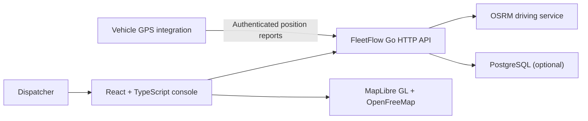

# FleetFlow Design

FleetFlow is a fleet-operations console for Jakarta. The product scope is defined
by [PRD.md](./PRD.md). It uses OSRM for driving routes and displays vehicle
positions reported by real integrations. It does not run traffic simulations or
compare routing experiments.

## System shape

## Runtime components

### Console

- React and TypeScript application under `console/`.
- MapLibre GL renders the interactive base map; OpenFreeMap supplies tiles.
- Route requests use geographic coordinates and the API returns OSRM route
  geometry, distance, and duration.
- Vehicle markers represent recent reports received through the location API.
  No synthetic movement or historical route trace is generated.
- Fleet, driver, and trip records are managed through the existing console and
  API.

### Go service

- `cmd/fleetflow` configures the service and its OSRM client.
- `internal/osrm` calls the configured OSRM HTTP API for driving routes and
  readiness checks.
- `internal/api` validates route and GPS requests, serves fleet records, and
  exposes health/readiness endpoints.
- GPS reports are authenticated and retained in bounded, short-lived in-memory
  storage; they expire if no fresh report arrives.
- PostgreSQL persistence is optional and follows the existing database
  configuration.

### Routing data

The OSRM service is separate from the FleetFlow API. `scripts/osrm/build-jakarta.ps1`
downloads the Geofabrik Java OpenStreetMap PBF, clips a buffered Jakarta-region
bounding box, and prepares OSRM MLD data. The exact extent is a practical
regional extract, not an official DKI Jakarta administrative boundary.

Downloaded PBF and generated OSRM files are local runtime data, not source
artifacts. Preserve OpenStreetMap attribution and ODbL obligations. The old
SUMO `.net.xml` file is a research artifact and is not loaded by the app.

## Service boundaries and failure behavior

- `OSRM_URL` configures the OSRM base URL. There is no internal-router fallback.
- `/readyz` checks OSRM and, when configured, PostgreSQL.
- OSRM unavailability and no-route results are returned as explicit API errors.
- Location responses include only actual recent GPS reports. Missing or stale
  data is represented as an empty result rather than fabricated positions.
- Map tile rendering depends on the configured external basemap provider.

## Deferred scope

Emissions tracking is intentionally deferred until FleetFlow has measured inputs
or a documented estimation model. Simulation, comparison, custom routing, and
unsupported emissions estimates are outside the current product.
