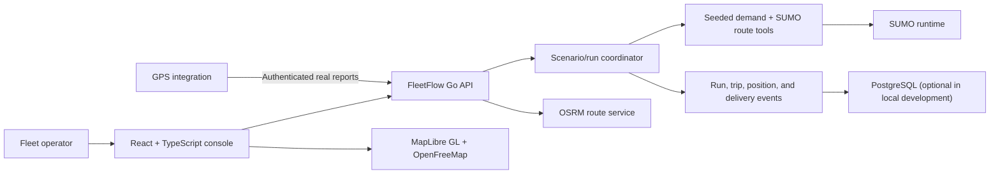

# FleetFlow Design

FleetFlow is a simulation-led fleet-operations console. The product contract is
defined by [PRD.md](./PRD.md). SUMO executes seeded traffic scenarios; OSRM
provides separate driving-route estimates; real GPS remains its own data source.
This document describes the intended boundaries, not a claim that every planned
component is already implemented. Progress is tracked in [TASKS.md](./TASKS.md).

## System shape

## Runtime components

### Console

- React and TypeScript application under `console/`; MapLibre GL renders
  OpenFreeMap tiles with visible attribution.
- Scenario controls select a named demand profile and seed. A run screen shows
  SUMO state and simulated positions; trip details show the route and ordered
  delivery history.
- Fleet and driver detail pages display operational attributes and history.
  Scenario dispatch has no manual trip-creation or assignment action.
- Map layers and labels keep SUMO movement distinct from reported GPS. There is
  no static demo-marker mode.

### Go API and scenario coordinator

- `cmd/fleetflow` configures the API, OSRM client, persistence, and simulation
  runtime.
- `internal/api` validates requests and exposes fleet records, scenarios, runs,
  generated trips, delivery events, routing, and real GPS endpoints.
- A scenario coordinator owns run lifecycle, deterministic demand inputs,
  automatic assignment, SUMO process execution, output collection, and errors.
  Long-running work must not be reported as complete before SUMO exits and
  outputs are validated.
- Run metadata records the seed, preset, network identity, SUMO version, and
  timestamps. PostgreSQL migrations persist runs, generated trips, stops,
  assignments, and ordered events; memory storage is for explicitly temporary
  local development only.
- Dispatch is deterministic and explainable: reject unavailable or
  incompatible vehicle/driver pairs, honor capacity and license/shift rules,
  and surface demand that cannot be assigned.

### SUMO and network data

- Generate repeatable trip demand with SUMO's supported demand and route tools,
  including a recorded seed; execute the resulting scenario with the SUMO
  binary, not the legacy graph simulator.
- Collect SUMO floating-car output for simulated map positions, trip information
  for completed movement, and emission output for modeled fuel/emissions.
  Convert output into API events while preserving simulated time and units.
- `SUMO_HOME`, the SUMO executable, and network path are validated explicitly.
  Missing tools, incompatible inputs, non-zero exits, and malformed output are
  visible errors; no mock run replaces them.
- `data/networks/jakarta.net.xml` is currently documented as a legacy
  central-Jakarta artifact, not a verified DKI-wide network. Do not enable it as
  the production scenario network until source, extent, licensing, and a
  representative route are verified. Keep downloaded source data and generated
  runtime outputs out of Git.
- Preserve OpenStreetMap attribution and ODbL obligations for derived network
  data. Document the exact geographic extent rather than claiming full Jakarta
  or metropolitan coverage without validation.

### Routing, map, and emissions

- SUMO routes simulated demand using its road network and route tools. OSRM is
  independently used by the existing route-estimate endpoint; no
  FleetFlow-owned shortest-path fallback is allowed.
- GPS endpoints accept authenticated reports. They never read SUMO output, and
  simulation endpoints never reinterpret GPS samples as simulation events.
- SUMO fuel and emissions are estimates under the configured vehicle/emission
  model. Persist model/version, units, and run assumptions; never label them as
  measured activity or verified carbon savings.
- A run records which engine produced it in a `runner` field (`sumo` or
  `synthetic`), and a synthetic run carries no SUMO version. A scenario that did
  not run through SUMO never claims it did.
- Emissions are charged per vehicle class (`internal/fleet`): each class names
  its fuel and its fuel burn per kilometre, and the class travels with every trip
  so the console can show why two vehicles on the same distance differ. The two
  paths are labelled separately because they are different models, and neither is
  a measured inventory.
- Basemap rendering depends on OpenFreeMap; routing and simulation runtime
  failures are surfaced rather than converted to fallback data.

### The routing lab

- `internal/lab` applies the idea from the author's thesis proposal — per-edge
  congestion state learned from probe reports — at grid scale. Each edge carries a
  congestion ratio smoothed by an exponential moving average, decayed toward free
  flow once per customization when it stops reporting, and published in an
  immutable metric snapshot behind an atomic pointer, so a route query never takes
  a write lock. Each edge owns its `sync.RWMutex`, so a report on one segment never
  blocks customization on another.
- The lab runs identical seeded demand twice on the same network: a static engine
  that always costs edges at free-flow time, and the dynamic engine. Both arms are
  priced against the congestion their own wave creates, so the comparison is between
  routing policies and not between two traffic conditions.
- Two modelling decisions decide whether the result means anything. Every simulated
  vehicle reports the speed it achieved, not only those routing on the metric,
  because that is what a fleet telematics feed is. And each driver reads the
  published metric through a private perception error: a thousand vehicles reading
  one number identically all divert onto the same street, which is a herding
  artefact of the model, and it made an early version of the experiment negative at
  full adoption.
- The network is a lattice built in code, with fast arterials every third street.
  Identical streets would leave the static router nothing to concentrate on, so
  there would be nothing for dynamic weights to recover. The grid's identity is its
  size, so a clone reproduces the experiment without a data file.
- It is not the research the proposal describes: no CCH, no TraCI loop, no LuST
  scenario, no Jakarta street plan, no measured traffic. Shortest paths come from
  Dijkstra. `GET /api/lab/dynamic` and **Settings → Routing Lab** carry the same
  statement in their method block, beside the numbers.

## Deployment and failure behavior

- `GET /healthz` reports process liveness. `GET /readyz` checks configured
  PostgreSQL, OSRM, and required simulation runtime according to deployment
  configuration.
- The production runtime must contain a supported SUMO installation or delegate
  execution to a durable worker. A local developer's `sumo.exe` is not a
  production dependency strategy.
- Run execution must be recoverable/observable across API restarts in
  production. In-process goroutines alone are not a durable run queue.
- API/database/SUMO/OSRM errors remain explicit. No service returns mock
  positions, trips, routes, or emissions on failure.
