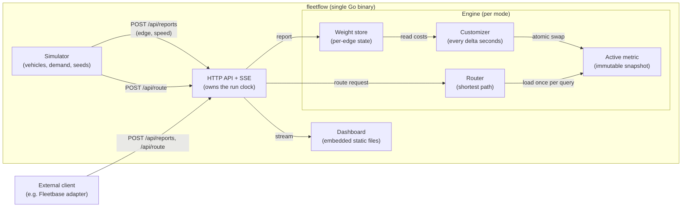

# FleetFlow: Design

**An open-source fleet navigation platform with dynamic weights.**
It keeps a fleet from congesting its own roads by re-weighting routes from live traffic.

Status: draft v0.1 (17 October 2026). Parameter values are starting points, to be tuned by experiment.

---

## 1. Goals and non-goals

### Goals
- Manage fleet records: vehicles, drivers with one-vehicle assignment, and trips (planned, in progress, completed), stored in PostgreSQL with rules enforced so nothing is lost or contradictory.
- Show that a fleet which routes with live, smoothed congestion weights finishes trips faster and saturates fewer roads than a fleet using static shortest paths.
- Make that visible in a live dashboard comparing both modes side by side on the same demand and seed.
- Ship as one small Go service that is easy to run, deploy and read.
- Let outside systems use the reports and route API with an API key, and accept real vehicle reports alongside simulated ones.
- Be honest about maturity: describe the result as a "production-shaped architecture, MVP feature set" (layered code, migrations, hashed keys, typed errors, health and readiness, graceful shutdown, validated config, tests in CI), and never as "production-ready".

### Non-goals (for this competition)
- Driver mobile or web app for sending GPS, raw-GPS map matching, multi-org roles and billing, city-scale routing, persisted congestion weights, real-fleet validation (all roadmap, see PRD section 9).
- Multi-stop optimization and dispatch/order management (fleet-tool territory, not this sprint).
- End-user accounts and login: the dashboard is open for the demo, and only the programmatic reports and route API is key-protected (the PRD allows one operator login or none).
- Real-world validation. All results come from simulation and must be described that way.
- Matching a full traffic simulator such as SUMO.
- Backups, an ops runbook beyond a sketch, and a full security review (all roadmap, see PRD section 9).
- API key rotation and revocation, and running more than one instance at a time (state is in memory, so this sprint is single-instance only; see PRD section 5).

### Positioning
FleetFlow is a congestion-aware routing layer that fleet management tools could call. It complements them and does not replace them.

---

## 2. System overview

One Go binary contains the routing engine, the simulator, the HTTP API and the embedded dashboard. Two engine instances run side by side in a comparison run: **baseline** (static free-flow weights) and **FleetFlow** (dynamic weights).



### Tech stack

Honest status, not the target: this is what is in the repository today versus what the plan still owes.

| Part | Choice | Status |
|---|---|---|
| Language | Go 1.25.5, module `fleetflow` | In place |
| Dependencies | Standard library only; no `go.sum` yet | In place |
| HTTP | `net/http` + `http.ServeMux` with method patterns; no framework | In place (only `GET /healthz`) |
| Routing | Hand-written Dijkstra behind a `Router` interface | In place |
| Simulation | Own deterministic mesoscopic model | In place |
| Persistence | PostgreSQL with versioned SQL migrations; driver not chosen yet | Planned (dev Postgres 17 runs in Docker; no Go code yet) |
| Dashboard | Plain HTML/CSS/JS on two canvases, no map tiles, embedded with `go:embed` | Planned (`web/` does not exist yet) |
| Streaming | Server-Sent Events | Planned |
| Deployment | Multi-stage Dockerfile to Cloud Run, `max-instances=1`; Fly as a preview | Planned (no Dockerfile yet) |
| CI | Build, vet, lint, `gofmt` and `go test -race` on every push | Planned |
| Testing | `go test` with table-driven unit tests; race detector run from WSL | In place |
| Database MCP (dev only) | Google MCP Toolbox for Databases, read-only role, off by default | In place (local only) |

### Why this shape
- **Single binary:** the easiest thing to build, test and deploy in a week.
- **Engine behind an interface:** the simulator and the HTTP API both use the same `Engine` interface, so external clients get the same behavior as the simulator.
- **The simulator is a client of the API:** it sends reports and route requests over the public HTTP endpoints, so simulated traffic is validated, authenticated and measured exactly like an external client. Only the weight refresh stays internal.
- **One run clock:** the server owns simulated time, so weight refresh, streaming and "stop when nobody is watching" cannot drift apart.
- **Immutable metric snapshot:** route queries never wait for weight updates.

---

## 3. Components

### 3.1 Road graph (`internal/graph`)
- Directed graph loaded once from `data/graph.json`. Nodes have `id, lat, lon`. Edges have `id, from, to, length_m, speed_limit_mps, lanes`.
- The topology is fixed for a run, so the edge slice is built once and never resized.
- **Derived values per edge:**
  - `free_flow_s = length_m / speed_limit_mps`
  - `capacity = lanes * length_m / 7.5` (vehicle length plus gap, an assumption; documented and tunable)
- **Data source:** a small Jakarta area extract from OpenStreetMap (attribution required, ODbL), produced by a one-time script in `scripts/`. Fallback: a generated grid city with arterial roads, so the demo never depends on the extract.

### 3.2 Weight store (`internal/weights`)
Per-edge mutable state, one lock per edge:

```go
type EdgeState struct {
    mu         sync.RWMutex
    rhoBar     float64   // smoothed congestion, 0..1
    lastReport time.Time // simulation or wall time of last report
    reported   bool      // received a report since last customization
}
```

**Congestion measure** from a report with speed `v`:

```
rho = clamp(1 - v / v_free, 0, 1)
```

**Smoothing (on each report):**

```
rhoBar = (1 - gamma) * rhoBar + gamma * rho
```

**Decay (once per customization cycle, for edges with no report since the last cycle and past the hold time):**

```
rhoBar = rhoBar * (1 - lambda)
```

**Edge cost:**

```
cost = free_flow_s * (1 + alpha * rhoBar^beta)
```

This follows the BPR form (free-flow time times a penalty that grows non-linearly), but is driven by observed speed instead of volume over capacity.

**Default parameters (starting points, to be tuned):**

| Parameter | Meaning | Start |
|---|---|---|
| alpha | penalty strength | 1.5 |
| beta | how sharply penalty rises | 2 |
| gamma | smoothing rate | 0.3 |
| lambda | decay rate per cycle | 0.1 |
| delta | customization interval (sim seconds) | 5 |
| hold | seconds without decay after a report | 10 |

### 3.3 Engine (`internal/engine`)
- **Customizer:** one goroutine. Every `delta`, it applies decay, reads every edge cost under `RLock`, writes them into a fresh `[]float64`, and publishes the new `*Metric` with `atomic.Pointer`.
- **Metric:** immutable struct holding `costs []float64` and a version number. It is never modified after publication.
- **Router:** loads the active metric pointer once at the start of a query and runs on it until done, so queries need no locks. MVP algorithm is **Dijkstra with a binary heap** (fast enough for a few thousand nodes). The router sits behind an interface, so a Customizable Contraction Hierarchy implementation can replace it later without changing callers.
- **Baseline engine:** same code, with the weight store disabled and the metric fixed to free-flow costs.

### 3.4 Simulator (`internal/sim`)
A simple mesoscopic model, not a full traffic simulator:

- Time advances in fixed steps (for example 1 simulated second).
- Each vehicle is on one edge with a position along it. Edge speed depends on occupancy:

```
v_edge = v_free / (1 + 0.15 * (N / capacity)^4)
```

  where `N` is the number of vehicles on that edge. This is the classic BPR volume-delay shape, reused to turn occupancy into speed.
- **Demand:** seeded random origin-destination pairs and departure times, identical for baseline and FleetFlow runs.
- **Vehicle groups:**
  - **Fleet vehicles** (a configurable share, the fleet share): request routes and send speed reports through the public API (`POST /api/route`, `POST /api/reports`), so they behave exactly like an external client. Reports are sent synchronously, one call per step, which keeps a seeded run deterministic.
  - **Background vehicles:** use static free-flow routes and never contact the API, but add to congestion.
- **Test seam:** `internal/sim` depends on a small `FleetService` interface. Production wires it to an HTTP client against the server's own base URL; tests inject the engine directly or a fake, so the simulator's logic is exercised without a network.
- **Run clock:** simulated time belongs to the server's run loop, which advances the simulator, refreshes the weights every `delta`, and stops when no client holds an open stream.
- **Rerouting policy:** a fleet vehicle requests a route at departure and then every `K` simulated seconds. It switches only if the new route is cheaper by more than a threshold (default 10%), which is the hysteresis that limits oscillation.
- **Determinism:** one seeded random source per run. Same seed gives the same demand.

### 3.5 HTTP API (`internal/api` + entity handlers)
Plain `net/http`. JSON in and out. `POST /api/reports` and `POST /api/route` require a valid API key (missing or wrong key returns 401 and does nothing). Hot path stays in memory and out of the database: reports write to the weight store only, route queries read the engine snapshot only.

| Method and path | Purpose |
|---|---|
| `POST /api/reports` | Submit `{vehicle_id, edge_id, speed_mps, ts}`; documented format, invalid or out-of-range values rejected with a clear error |
| `POST /api/route` | `{from_node, to_node}` returns `{edges, cost_s, metric_version}` |
| `GET /api/metrics` | Current counters and comparison metrics |
| `GET /api/stream` | Server-Sent Events: vehicle positions, edge congestion, metrics (each vehicle labeled simulated or live) |
| `POST /api/sim/start` | Start a run with `{seed, vehicles, fleet_share, delta, params...}` |
| `POST /api/sim/reset` | Stop and clear the run |
| `GET /api/vehicles`, `POST /api/vehicles` | List and create vehicles `{name/plate, type, status}` with validation |
| `GET /api/drivers`, `POST /api/drivers` | List and create drivers `{name, contact}` |
| `POST /api/vehicles/{id}/driver` | Assign or unassign a driver (one vehicle per driver enforced) |
| `GET /api/trips`, `POST /api/trips` | List and create trips `{origin, destination, vehicle_id}` with assignment rules (vehicle must be available, not offline or on a trip; enforced atomically so concurrent requests cannot double-assign) |
| `POST /api/trips/{id}/status` | Advance a trip (planned, in progress, completed) and keep the vehicle status in step; the run loop does this for simulated trips, and the dispatcher can override |
| `GET /api/runs`, `POST /api/runs` | List finished comparison runs and save the current one `{seed, config, metrics}` (US-9) |
| `GET /healthz` | Liveness |
| `GET /readyz` | Readiness: graph loaded, DB reachable when configured |

Every entity follows handler → service → repository, including vehicles, drivers, trips, runs and API keys. Consistency matters more than saving a file: new contributors and AI agents can predict where anything goes. Repository interfaces are defined in the service package (or `domain/`), with `postgres/` and `memory/` implementations behind them. Services are unit-tested against `memory/`; integration tests run against a real Postgres (e.g. in Docker). The routing core (`graph`, `weights`, `engine`) imports nothing from the HTTP or database layers.

Fleet records (vehicles, drivers, trips, completed-trip history, saved comparison runs) live in PostgreSQL and survive a server restart; schema changes go through versioned migrations. API keys are stored hashed, never in plain text, and never written to logs. Live congestion state stays in memory on the single instance. `GET /api/metrics` reports trip and congestion metrics plus the engineering numbers: route query latency (p50, p99), customization time and metric age.

Server-Sent Events are used instead of WebSockets because they are one-way, simpler, and work through both Cloud Run and Fly.

### 3.6 Dashboard (`web/`)
- Static HTML, CSS and vanilla JavaScript embedded into the binary with `go:embed`.
- Draws the road graph on a `<canvas>` from node coordinates, so it needs no map tiles or outside services.
- Fleet management views: vehicle list with status, driver list with vehicle assignment, trip creation (origin/destination picker from map or known places) with assignment and status display, trip history and saved comparison runs.
- Two panels side by side (Baseline and FleetFlow) with vehicles as dots and edges colored by congestion.
- Live fleet map: vehicle markers move as positions arrive over SSE with auto-reconnect; each vehicle is labeled simulated or live.
- Metrics strip: average trip time, 95th percentile trip time, saturated roads (%), route changes, route query latency, fleet vs. background trip times, with the capacity derivation stated so the saturation figure is not a black box.
- Controls: start, reset, seed, number of vehicles, fleet share.

### 3.7 Persistence (`internal/<entity>/` service + repository, `internal/store`)
- PostgreSQL for vehicles, drivers, trips, saved runs, and hashed API keys. Live congestion state stays in memory (see `internal/weights`).
- Layout per entity: `handler` (HTTP, validation, status mapping) → `service` (rules, transactions, owns the repository interface) → `repository` (`postgres/` real implementation, `memory/` fake for unit tests).
- Versioned migrations only, never hand-edited schema. Assignment rules (one vehicle per driver, no double trip assignment) enforced in the database and under concurrency.
- Connection pooling configured; indexes on the foreign keys and status columns that are filtered by.
- Hot path stays out of the database: reports and route queries never touch PostgreSQL.
- No real driver locations are collected during the competition; Indonesia's data protection law (UU PDP) is reviewed before any pilot.

### 3.8 Cross-cutting: config, errors, observability, resilience
- **Config:** all settings from environment variables, validated at startup; the app refuses to start on bad config.
- **Errors and validation:** typed domain errors mapped to status codes in one place; request size limits and input validation at the handler.
- **Observability:** structured logs with request IDs; `GET /healthz` (liveness) and `GET /readyz` (readiness); metrics already planned (route query latency, customization time, metric age).
- **Resilience:** graceful shutdown (stop the customizer and simulation, drain requests); timeouts on every outbound call and query; rate limiting on public endpoints.
- **Testing:** unit tests on services with memory repositories; integration tests against a real Postgres (e.g. in Docker); `-race` on the engine; tests run in CI on every push.
- **State:** in-memory weights mean one instance per region (`max-instances=1`). Persisted state or a restart plan is roadmap; multi-instance needs a different approach.

---

## 4. Concurrency model

| Actor | Touches | Synchronization |
|---|---|---|
| Report handlers / simulator | one edge's `EdgeState` | that edge's `Lock()` |
| Customizer (1 goroutine) | all `EdgeState`s (read) | each edge's `RLock()`, one at a time |
| Customizer, publish | active metric pointer | `atomic.Pointer.Store` |
| Route queries | active metric pointer | `atomic.Pointer.Load` once, no locks |
| Run clock (1 goroutine) | simulator, weight refresh, stream fan-out | owns simulated time; readers get snapshots |
| Fleet record writes | PostgreSQL rows | one transaction per assignment plus database constraints, so two concurrent requests cannot both assign the same vehicle |
| Trip status changes | PostgreSQL rows | updated in the same transaction as the trip and the vehicle status |

Properties:
- Queries are never blocked by reports or customization.
- A query never sees a half-built metric.
- The snapshot is read edge by edge, so it is not one atomic view of the whole network. Each edge value is internally consistent, and the difference between edges is bounded by the read time.
- Old metrics are freed by the garbage collector once no query references them.
- Fleet records are the only shared mutable state outside the engine; the database, not in-process locks, is what makes concurrent assignments safe.
- Verified with `go test -race ./...`.

---

## 5. Known failure modes and mitigations

| Failure mode | Why it happens | Mitigation in this design |
|---|---|---|
| **Avoidance blind spot** | Fleet vehicles avoid a congested road, so nobody reports on it, it decays to free-flow, and vehicles flood back. | Hold time before decay starts, slow decay rate, and hysteresis in rerouting. Measure route changes to detect it. Background traffic keeps real congestion in the simulation. |
| **Route oscillation** | Many vehicles switch routes at once when costs change. | Hysteresis threshold, smoothing (`gamma`), longer `delta`, staggered reroute times per vehicle. |
| **Stale weights** | Queries use the metric from the last customization. | Report customization time and metric age, and compare across `delta` values. |
| **Sparse coverage** | Low fleet share means few reports. | Compare results at several fleet shares (for example 25%, 50%, 100%). |
| **Over-penalization** | Penalty too strong forces needless detours. | Tune `alpha` and `beta`, and compare fleet trip time against baseline. |

---

## 6. Evaluation

Each comparison run uses the same seed and demand for both modes.

**Metrics**
- Average and 95th percentile trip time
- Total time lost versus free-flow time
- Saturated roads (%): edges where `N >= capacity`
- Standard deviation of edge utilization (`N / capacity`)
- Route changes per vehicle
- Fleet vs. background vehicle trip times (a fairness check)
- Engineering: route query latency (p50, p99), customization time, metric age

**Method:** repeat each configuration over several seeds and report the mean and spread. The dashboard shows a single live run, and a script or the metrics endpoint records the multi-seed results for the write-up.

---

## 7. Deployment

### Targets
| Target | Purpose |
|---|---|
| **Cloud Run** | **Submission target (required by the competition rules).** |
| **Fly.io** | Optional quick preview and dev environment. Same container. |

The Fly path is easy for iteration, but the playbook says projects must be deployed via Cloud Run, so the **submitted deployment link must be Cloud Run**. Confirm with the organizers if Fly is acceptable as an additional deployment.

### One image for both
- Multi-stage `Dockerfile`: build the Go binary, copy it into a small runtime image.
- Listens on `$PORT` (default `8080`). Cloud Run sets `PORT`; for Fly set `internal_port = 8080` in `fly.toml`.
- Dashboard and graph data are embedded, so the container needs no volumes.

### Cloud Run settings
- `max-instances=1`, because live congestion state is in memory (PostgreSQL holds fleet records externally, but each instance would still build its own congestion view).
- `min-instances=1` for demo day, so the first request is not a cold start.
- The simulator runs in background goroutines, and Cloud Run throttles CPU outside of requests by default. Either set CPU to always allocated, or run the simulation only while a client holds an open `/api/stream` connection. This design uses the second option as the default so it also works with default settings.
- Request timeout raised for long-lived SSE connections, with the dashboard auto-reconnecting.

### Fly settings
- One machine, kept running (no auto-stop) during demos.
- `fly launch` then `fly deploy`; no extra services needed.

---

## 8. Repository layout

```
fleetflow/
├── cmd/fleetflow/main.go      # wiring, env-validated config, graceful shutdown
├── internal/
│   ├── graph/                 # routing core: graph types and JSON loader (no http/db imports)
│   ├── weights/               # routing core: edge state, smoothing, decay, cost
│   ├── engine/                # routing core: customizer, metric snapshot, router
│   ├── domain/                # shared types + typed domain errors mapped to status codes
│   ├── vehicle/               # handler → service → repository (interface in service; postgres/ + memory/)
│   ├── driver/                # handler → service → repository (same shape as vehicle)
│   ├── trip/                  # handler → service → repository (assignment in one transaction)
│   ├── run/                   # saved comparison runs, same layered shape
│   ├── auth/                  # API key issue/verify (hashed storage, no plaintext logs)
│   ├── store/                 # PostgreSQL connection pool, versioned migrations
│   ├── config/                # env parsing + startup validation (refuse to start on bad config)
│   ├── sim/                   # vehicles, demand, rerouting policy (client of the public API)
│   └── api/                   # HTTP wiring: routes, middleware (request ID, limits, rate limit), SSE
├── web/                       # embedded dashboard (HTML, CSS, JS)
├── data/graph.json            # road graph extract
├── scripts/                   # one-time OSM extraction
├── Dockerfile
├── fly.toml
├── README.md
├── DESIGN.md                  # this file
├── AGENTS.md
├── NOTICE                     # attributions (OpenStreetMap, libraries)
└── LICENSE
```

---

## 9. Build plan (small commits, one step at a time)

Deployment deadline is **24 October**. Commit after each step, as described in `AGENTS.md`.

| Day | Date | Work |
|---|---|---|
| 1 | Sat 17 Oct | Repo, LICENSE, README skeleton, Go module, graph types and loader, small test graph |
| 2 | Sun 18 Oct | Weight store (smoothing, decay, cost) with tests |
| 3 | Mon 19 Oct | Engine: customizer, atomic metric, Dijkstra router, race tests |
| 4 | Tue 20 Oct | Simulator: demand, edge speed model, fleet vs. background vehicles, rerouting, trip metrics, baseline comparison |
| 5 | Wed 21 Oct | API and SSE stream, layered fleet records (handler → service → repository, postgres + memory), migrations, API keys, simulated traffic on the public API, route query latency, config validation, typed errors, readiness, graceful shutdown |
| 6 | Thu 22 Oct | Dashboard: fleet views, canvas map, side-by-side panels, controls, metrics strip, simulated/live labels |
| 7 | Fri 23 Oct | Dockerfile, Cloud Run deployment (and Fly preview), tuning runs, fleet-share sweep |
| 8 | Sat 24 Oct | Buffer, README polish, shipped and verified |
| | 25 to 27 Oct | Demo video, 500-word summary, deck, pitch practice |

**Cut order if time runs short:** stretch work, then dashboard polish (T56), then the Fly preview (T59), then the multi-seed batch script and the fleet-share sweep, then the fairness metrics and saved runs, then US-14 reports docs. Never cut PostgreSQL fleet records, API keys, simulated traffic on the public API, route query latency, the side-by-side dashboard comparison, the Cloud Run deployment, or the honest results record.

---

## 10. Optional: Fleetbase integration (post-sprint roadmap)

- Implemented as a small separate adapter that talks to Fleetbase over its REST API or webhooks and to FleetFlow over `/api/route` and `/api/reports`, using the API key from US-13.
- Keeps FleetFlow a separate service, so AGPL-3.0 obligations of Fleetbase do not extend to this repo. This is not legal advice, so check Fleetbase's licensing page before bundling anything.
- Verify the exact Fleetbase endpoints and events in their docs before building.
- Demonstrated locally or in a recorded clip. Fleetbase itself is heavy and is not deployed to Cloud Run.

---

## 11. Decision log

| Decision | Choice | Reason |
|---|---|---|
| Language | Go | Concurrency primitives match the design, single static binary |
| Router (MVP) | Dijkstra behind an interface | Fast enough for a few thousand nodes, CCH can be swapped in later |
| Simulator | Own mesoscopic model | Runs without SUMO installed, deterministic, easy to deploy |
| Live updates | Server-Sent Events | Simpler than WebSockets, enough for one-way streaming |
| Dashboard | Canvas, no map tiles | No outside dependencies, works offline |
| State | In memory (single instance) for congestion; PostgreSQL for fleet records | Persistent records survive restarts, congestion rebuilds from fresh reports |
| Architecture | Handler → service → repository per entity; the routing core (`graph`, `weights`, `engine`) imports no HTTP or database package | Predictable layout for contributors and agents, and the hot path cannot reach the database by accident (PRD US-5, US-12) |
| Deployment | Cloud Run for submission, Fly for preview | Competition rule, with Fly kept as a convenience |
| Database | PostgreSQL, hosted externally (Cloud SQL vs. free tier TBD) | Fleet records must survive restarts; congestion stays in memory |
| Dev vs production database | Separate databases and credentials; the dev entry pins the host to `127.0.0.1` and is writable | Broad DDL/DML is safe in development when the dev target is a disposable local database that structurally cannot be production |
| Simulated reports | Through the public API (`POST /api/reports`, `POST /api/route`) | Simulated and external traffic take the same validated path (PRD US-7), and one run clock keeps refresh and streaming in step |
| End-user auth | None; an API key only on the reports and route endpoints | Keeps the demo open, while the programmatic surface is honest about access (PRD US-13) |
| Post-sprint order | Pilot, driver app, map matching, orgs/roles + tenant separation, key rotation/revocation, persisted weights + multi-instance plan, CCH, Fleetbase adapter, backups + runbook | Per PRD section 9 |

---

## 12. Open questions

- Is an additional Fly.io deployment acceptable alongside the required Cloud Run one?
- Which area of Jakarta, and how many nodes, makes the best demo within the time available?
- Where to host PostgreSQL (Cloud SQL vs. an external free tier) and the cost during the competition?
- Do we need a plan for who maintains the project after the competition?
